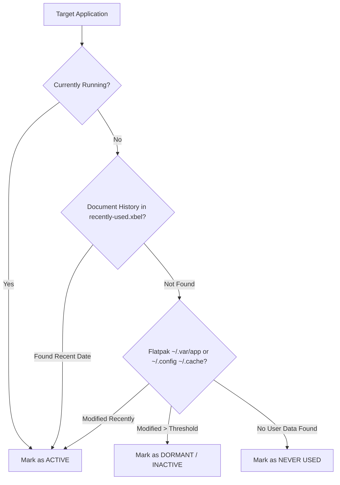

# 🧹 AppPrune (find-unused-apps)

> **Intelligent application usage auditor & bloat finder for Linux (APT, Flatpak, COSMIC, GNOME).**  
> Identifies abandoned, never-used, and duplicate applications to safely reclaim gigabytes of disk space.

[](https://www.python.org/)
[](https://opensource.org/licenses/MIT)
[](#supported-environments)
[-green.svg)](#)

---

## 🎯 The Problem

Over months and years, Linux systems accumulate dozens of unused applications:
* Flatpaks taking gigabytes in runtime and cached app data.
* Chat clients, network analyzers, LaTeX suites, or screen recorders installed for one-time tasks and forgotten.
* Redundant duplicate installs (e.g. Google Chrome installed as both a native `.deb` package and a Flatpak).
* Because modern Linux systems mount filesystems with `noatime` or `relatime`, traditional binary access times (`atime`) do not reliably reveal when an application was last executed.

**AppPrune** solves this by cross-referencing multiple real-world activity signals across the system to accurately determine when an application was actually last used.

---

## ✨ Features

- **🔍 Multi-Source Activity Detection**: Correlates Freedesktop document history (`recently-used.xbel`), Flatpak user data directories (`~/.var/app/`), configuration/cache stores (`~/.config`, `~/.cache`, `~/.local/share`), home dotfiles, shell history (`.bash_history`, `.zsh_history`), and the active process table.
- **🛡️ Desktop Environment Safe**: Differentiates third-party user apps from critical system dependencies (`pop-desktop`, `ubuntu-desktop`, `cosmic-session`). You will never be told to uninstall your file manager, terminal, or core settings.
- **👯 Duplicate / Redundancy Detection**: Flags applications installed simultaneously across multiple packaging formats (e.g. APT `.deb` vs. Flatpak).
- **💾 Disk Space Accounting**: Calculates total reclaimable space including package sizes and user cache/state directories.
- **📋 Copy-Paste Cleanup Commands**: Generates safe, verified terminal commands (`flatpak uninstall --delete-data`, `sudo apt remove --purge`) to clean up with a single click.
- **⚡ Zero External Dependencies**: Written entirely in pure Python standard library—no `pip install` required.
- **📊 Formats**: Terminal color table, sorted views, or structured `--json` output for scripting.

---

## 🚀 Quickstart

### 1. Clone or Download

```bash
git clone https://github.com/your-username/app-prune.git
cd app-prune
chmod +x find_unused_apps.py
```

### 2. Run an Audit

```bash
# Audit applications inactive for > 60 days (default)
./find_unused_apps.py
```

### 3. Generate Cleanup Commands

```bash
# Output safe terminal commands to remove unused applications
./find_unused_apps.py --clean-commands
```

---

## 📖 CLI Usage & Options

```text
usage: find_unused_apps.py [-h] [-d DAYS] [-a] [--system]
                           [--sort {days,size,name}] [--clean-commands]
                           [--json] [--no-color]

Audit installed Linux applications and identify unused, dormant, or redundant apps.

options:
  -h, --help            Show this help message and exit
  -d DAYS, --days DAYS  Inactivity threshold in days (default: 60)
  -a, --all             Display all installed applications, including active ones
  --system              Also audit pre-installed system utilities (default: shows user/third-party apps)
  --sort {days,size,name}
                        Sort results by 'days' (default), 'size', or 'name'
  --clean-commands      Print clean copy-pasteable terminal commands to uninstall unused apps
  --json                Output results as structured JSON
  --no-color            Disable ANSI color styling
```

### Examples

```bash
# Find apps not used in the last 6 months (180 days)
./find_unused_apps.py -d 180

# Sort by disk space to see biggest space hogs first
./find_unused_apps.py --sort size

# Inspect everything including active applications
./find_unused_apps.py --all

# Pipe structured JSON into jq
./find_unused_apps.py --json | jq '.user_apps[] | {name, last_active, disk_size_fmt}'
```

---

## 🖥️ Sample Output

```text
========================================================================================
                  LINUX APPLICATION USAGE AUDITOR (Pop!_OS / COSMIC)                    
========================================================================================
Threshold: Inactive for > 60 days | User Apps Audited: 37
Unused User Apps Detected: 22
Reclaimable Space (User Apps): 2.0 GB

--- UNUSED USER & THIRD-PARTY APPLICATIONS (Safe to Remove) (22) ---
STATUS          APPLICATION                  TYPE       LAST USED      SPACE       EVIDENCE / SOURCE
---------------------------------------------------------------------------------------------------------
[NEVER USED]    SimpleScreenRecorder         APT/deb    Never          3.7 MB      No user activity recorded
[NEVER USED]    iptux                        APT/deb    Never          1.1 MB      No user activity recorded
[NEVER USED]    Geary                        APT/deb    Never          12.1 MB     No user activity recorded
[NEVER USED]    Extension Manager            APT/deb    Never          760.0 KB    No user activity recorded
[DORMANT >6M]   Discord                      APT/deb    2024-12-02     10.0 MB     Config/Cache: ~/.config/discord
[DORMANT >6M]   Wireshark                    APT/deb    2025-01-23     10.2 MB     Config/Cache: ~/.config/wireshark
[DORMANT >6M]   TeXworks                     APT/deb    2025-08-31     5.3 MB      Document history (texworks)
[DORMANT >6M]   SimpleX Chat                 Flatpak    2026-02-16     909.3 MB    Flatpak user data: ~/.var/app/chat.simplex.si
[DORMANT >6M]   Teams for Linux              Flatpak    2026-04-08     329.7 MB    Flatpak user data: ~/.var/app/com.github.Isma
[INACTIVE]      Telegram                     Flatpak    2026-09-04     254.7 MB    Flatpak user data: ~/.var/app/org.telegram.de

[!] REDUNDANT / DUPLICATE INSTALLATIONS DETECTED:
  • Google Chrome is installed in multiple formats:
    - [APT/deb] (google-chrome-stable): Last used Never (NEVER_USED) - 451.4 MB
    - [Flatpak] (com.google.Chrome): Last used 2026-10-30 (ACTIVE) - 46.6 MB

=== RECOMMENDED CLEANUP COMMANDS (COPY & PASTE) ===

# 1. Remove unused Flatpaks and clear their user data caches:
flatpak uninstall --delete-data -y chat.simplex.simplex com.github.IsmaelMartinez.teams_for_linux org.telegram.desktop

# 2. Remove unused APT packages and purge configuration files:
sudo apt remove --purge -y discord wireshark simplescreenrecorder iptux geary google-chrome-stable
sudo apt autoremove --purge -y
```

---

## 🔬 How Activity Detection Works

Under standard Linux installations with modern filesystems (`ext4`, `btrfs`, `zfs`), binary access timestamps (`atime`) are not updated on every execution because the mount options use `noatime` or `relatime`.

To bypass this limitation, AppPrune queries reliable stateful activity indicators:



1. **Freedesktop Recents (`recently-used.xbel`)**: Tracks files opened, saved, or manipulated by desktop applications.
2. **Flatpak Sandbox State (`~/.var/app/<app-id>`)**: Flatpaks read and update local configs, caches, and storage within their sandbox root each time they launch.
3. **XDG User Storage (`~/.config`, `~/.cache`, `~/.local/share`, `~/.<app>`)**: Checks directory modification timestamps for application configurations.
4. **Desktop Metapackage Resolution**: Resolves reverse dependencies of desktop environments (such as `pop-desktop`, `ubuntu-desktop`, `cosmic-session`) to classify applications as either **Safe-to-remove User Apps** or **Protected System Components**.

---

## 🐧 Supported Environments

- **Distributions**: Pop!_OS, Ubuntu, Debian, Linux Mint, and other Debian-derived distributions.
- **Desktop Environments**: COSMIC DE, GNOME, KDE Plasma, XFCE.
- **Package Systems**: Flatpak, APT / `.deb`.

---

## 🤝 Contributing

Contributions, bug reports, and suggestions are welcome!
1. Fork the repository
2. Create your feature branch (`git checkout -b feature/snap-support`)
3. Commit your changes (`git commit -m 'Add Snap package audit support'`)
4. Push to the branch (`git push origin feature/snap-support`)
5. Open a Pull Request

---

## 📄 License

This project is licensed under the [MIT License](LICENSE).
